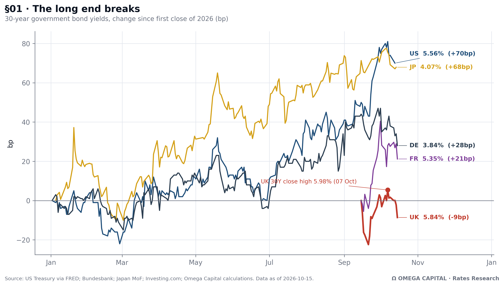
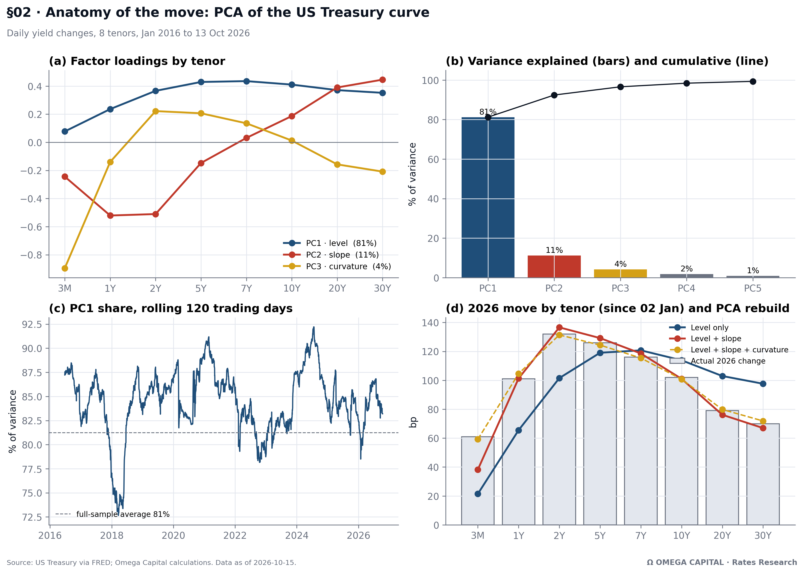
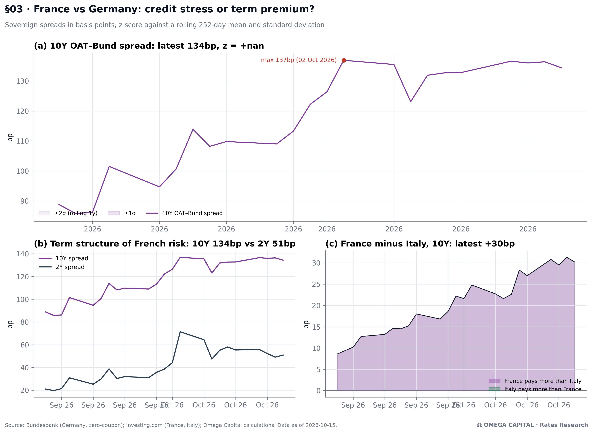
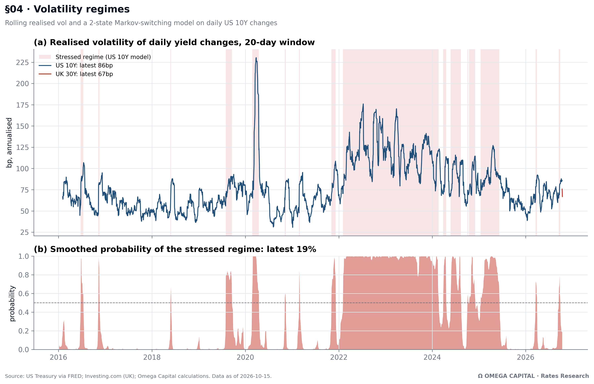
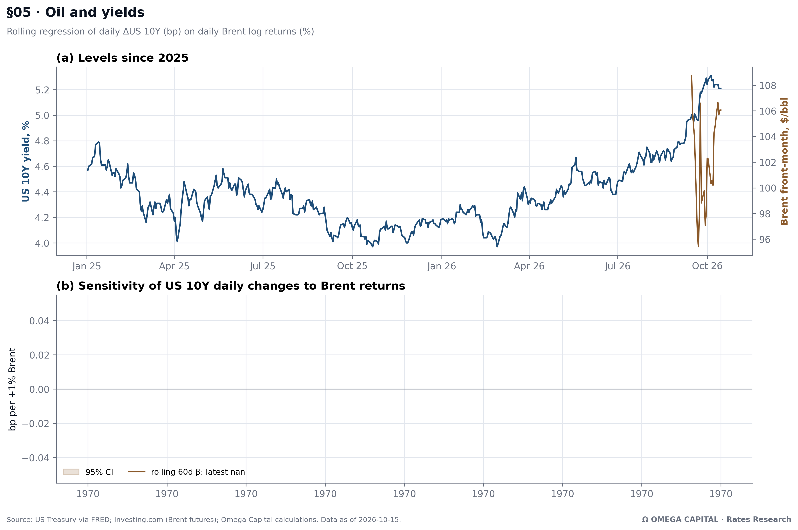

# Ω Omega Capital · Rates Research
## The 2026 Global Bond Selloff

> **Status:** analysis done, report not yet written. Data as of **15 Oct 2026** (US Treasury data to 13 Oct).
> **Analysis:** Leo · **Report writing & final view:** _[partner]_
>
> This README is the hand-over. It covers what we built, what the data says, the take-away we propose for Omega, and what is still open. The numbers below were read off the charts. **Use the `Headline numbers` cell at the end of the notebook for exact figures.**

---

## 1 · The one-paragraph story (draft, for the partner to rewrite)

The 2026 bond selloff is **not one selloff but two**. From spring to September, the US move was a **policy repricing**: the 2Y–5Y sector rose more than 120bp as markets priced the Fed's return to hiking, and the US curve **flattened**. Since mid-September, a second phase has started: a **synchronised global long-end selloff** driven by fiscal and term-premium fears. This phase has hit the UK, France and Japan hardest, and has now pulled the US 30Y to around 5.6%.

The move is large but so far **orderly**. US rates volatility is well below its 2022–23 levels, and our regime model puts the market back in the *calm* state. The **risk we flag** is that a leveraged market (basis trade, mortgage hedging) turns this orderly repricing into a disorderly one.

---

## 2 · Key findings by chart

### §01 · The long end breaks: global 30Y yields


| Market | 30Y now | Change 2026 | Read |
|---|---|---|---|
| US | 5.56% | **+70bp** | Flat until May, then two legs up; about +35bp since mid-September alone |
| Japan | 4.07% | **+68bp** | The steadiest grind higher all year; the end of the "JGBs never sell off" era |
| Germany | 3.84% | +28bp | The anchor: it moves with the others but much less |
| UK | 5.84% | ⚠️ data issue | Closing high **5.98% on 7 Oct**; it traded above 6% intraday on 1 Oct, the highest since 1998 |
| France | 5.35% | ⚠️ data issue | See §03 |

**Status:** ⚠️ The UK and France lines only cover about a month (see §5, To-do). Their yield change and price-loss figures are wrong until the files are re-downloaded.

---

### §02 · Anatomy of the move: PCA of the US Treasury curve


- **Level (PC1) explains 81%** of daily curve moves since 2016. Slope adds 11% and curvature 4%, so **three factors explain about 96%**.
- **The 2026 move is belly-led, not long-end-led** (bp):

  | 3M | 1Y | 2Y | 5Y | 7Y | 10Y | 20Y | 30Y |
  |---|---|---|---|---|---|---|---|
  | +61 | +101 | **+132** | **+126** | +116 | +102 | +79 | +70 |

- The curve **bear-flattened** this year: 2s30s is down about 60bp. A level-only model gets the long end wrong (it implies about +98bp at 30Y against +70bp actual). Adding the **slope factor** fixes the fit. That is the quant evidence that the US story is Fed repricing.
- The rolling PC1 share is about 83%, close to its 81% average. Moves are mostly parallel, with **no sign of curve dislocation**.

**Status:** ✅ Complete (FRED data, full history).

---

### §03 · France vs Germany: credit stress or term premium?


What we can already see (mid-September to mid-October only):
- **10Y OAT–Bund:** from about 89bp to a **137bp close high on 2 Oct**, now about 134bp.
- **2Y spread:** from about 21bp to about 51bp, after peaking around 71bp on 2 Oct.
- The **10Y spread is still more than twice the 2Y spread**. The market prices *long-run fiscal sustainability* risk, not near-term default. But the 2Y spread did more than double, so some near-term political risk is in the price too.
- **France now yields about 30bp more than Italy at 10Y**, up from about +9bp. That is a symbolic reversal worth leading the section with.

**Caveats for the text:**
1. Germany comes from the Bundesbank *zero-coupon* curve, while France comes from Investing.com *benchmark* yields. Our spread therefore runs a few bp off press figures.
2. We use **closing** data. The ~150bp+ widely reported for 2 Oct was intraday.

**Status:** ❌ Only about one month of French and Italian data. The z-score shows `nan` and the x-axis labels repeat. Both fix themselves with the full download.

---

### §04 · Volatility regimes


- The 2-state Markov-switching model on daily US 10Y changes finds a **stressed regime** in 2020 (COVID) and **from 2022 to mid-2025** (the Fed hiking cycle).
- **2026 has been mostly calm.** There were only two short stress episodes, around March–April and late September/early October, when the stressed-regime probability peaked near 0.8. **The latest probability is about 19%.**
- US 10Y realised vol is about **86bp annualised**, up from about 45bp in January 2026 but **far below the 100–175bp of 2022–23**.
- **Key message:** the yield *level* is extreme, but the *volatility* is not. That makes this an orderly repricing, which strengthens the "watch the plumbing" argument: the risk is a regime switch.

**Status:** ✅ The US part is complete. ⚠️ The UK 30Y vol line is only a stub until the full download.

---

### §05 · Oil and yields


**Status:** ❌ The Brent file only covers about a month (roughly $96–109/bbl), so the 60-day rolling beta can't be estimated yet and panel (b) is empty. Re-download, then read off the β table: 2016–25 vs 2026 vs the last 60 days.

**What we expect to say:** whether the US 10Y has become *more* sensitive to oil in 2026 (the energy-shock and Iran war channel), and how many bp per +10% Brent.

---

## 3 · Proposed Omega take-away (for the partner to decide)

| # | Take-away | Evidence | Confidence |
|---|---|---|---|
| 1 | **Two selloffs, not one.** US = Fed repricing (belly-led, bear-flattening); UK/France/Japan = fiscal long-end story | §02 attribution, §01 timing | High (US); medium until the UK/FR data is fixed |
| 2 | **Phase 2 is global and long-end.** Since mid-September the long end is moving everywhere at once | §01 | Medium |
| 3 | **France is a term-premium story, not a default story,** but France > Italy is a regime change | §03 | Medium (needs full data) |
| 4 | **Orderly, for now.** Level extreme, vol not; regime model calm | §04 | High |
| 5 | **The tail risk is plumbing:** basis-trade unwind, Treasury clearing mandate (late 2026), mortgage convexity hedging | Literature + §04 | Qualitative |

**Suggested framing:** _"Rates have repriced, not broken. The level is the story; the volatility is the warning light to watch."_

---

## 4 · Report outline and owners

| Section | Content | Chart | Owner |
|---|---|---|---|
| Key takeaways | 3–5 bullets, page 1 | none | _partner_ |
| §01 What happened | Timeline: Fed hike in Sept, UK 6% on 1 Oct, OAT spread on 2 Oct, IMF warning on 7 Oct, US CPI on 14 Oct | 1 | _partner_ |
| §02 Anatomy of the move | PCA, two-phase argument | 2 | _partner_ (Leo reviews numbers) |
| §03 France | Spreads, France vs Italy | 3 | _partner_ |
| §04 Vol & plumbing | Regimes, basis trade, clearing, convexity | 4 | _partner_ |
| §05 Drivers | Oil, deficits, AI capex issuance | 5 | _partner_ |
| §06 Scenarios & catalysts | Base / bear / bull with triggers; calendar (late-Oct FOMC, UK Budget 28 Oct, BoE 5 Nov, French budget vote) | none | _partner_ |
| Appendix | Data, methodology, disclaimer | none | Leo |

**Writing rules:**
- Research, not advice. Write "we expect" and "scenarios", never "buy" or "investors should".
- Every number dated and sourced. A source line goes under every chart (already on the PNGs).
- Close with the standard Omega disclaimer (see below).

---

## 5 · To-do

**Blocking (Leo):**
- [ ] Re-download from Investing.com, **Daily, 01/01/2016 → today**. Set the date range *before* clicking Download.
  - `UK 30Y`, `France 2Y`, `France 10Y`, `France 30Y`, `Italy 10Y`, `Brent Oil Futures`
- [ ] Restart the kernel and Run All. The data-check cell must print **no** "WARNING: … cut short".
- [ ] Re-export charts 1, 3 and 5, and update the numbers in this README.

**Partner:**
- [ ] Decide the final take-away (§3) and the scenario probabilities.
- [ ] Draft the text sections.
- [ ] Cross-check the headline numbers in the text against official sources (Treasury, BoE, Banque de France, MoF).

---

## 6 · Repository

```
bond-analysis/
├── README.md                 ← this file
├── omega_bond_report.ipynb   ← all analysis; Restart & Run All
├── get_all_data.py           ← downloads US (FRED), Germany (Bundesbank), Japan (MoF), Brent (Yahoo)
├── data/                     ← raw CSVs (Date, Price)
└── charts/                   ← 300-dpi PNGs, generated by the notebook
```

**Data sources**

| Series | Source |
|---|---|
| US Treasury 3M–30Y | FRED (`DGS*`), official |
| Germany 2Y/10Y/30Y | Bundesbank, Svensson zero-coupon curve |
| Japan 30Y | Japan Ministry of Finance |
| UK 30Y, France 2Y/10Y/30Y, Italy 10Y, Brent futures | Investing.com, manual download |

**Requirements:** `pandas numpy matplotlib statsmodels` (plus `yfinance`, optional, for the data script).

**Methods in one line each:**
- **PCA:** eigen-decomposition of the covariance of daily bp changes across 8 tenors.
- **Regimes:** `statsmodels` MarkovRegression, 2 states, switching variance.
- **Oil beta:** rolling 60-day OLS of ΔUS10Y (bp) on Brent log returns (%), with a 95% confidence interval.
- **Bond P&L:** exact repricing of a 30Y semi-annual par bond.

---

_Omega Capital is a student association. Nothing in this repository constitutes investment advice or a solicitation to invest. Paper trading only._